# 📄 Alcance del Sistema — Festa

Basado en `Requerimientos.docx`, en [`requirements.md`](../requirements/requirements.md) y en el modelo C4 de [`festa.dsl`](./festa.dsl). Este documento reúne y explica todos los diagramas de arquitectura de Festa: contexto, contenedores, componentes, vista dinámica, clases y base de datos.

> **Estado:** la arquitectura sigue los repositorios `Desparcha2-SWNT/festa-*` (24-oct-2026), que al 25 de octubre solo tienen README, y el despliegue en Azure decidido por el equipo el 25-oct-2026. Los componentes internos, las clases y las tablas son una **propuesta de diseño**; lo que depende del almacén de datos de cada servicio queda pendiente del ADR 0002.

## 1. Sistema

* **Nombre del sistema:** Festa
* **Objetivo:** El sistema tiene como objetivo centralizar el descubrimiento de eventos y planes en un mapa interactivo en tiempo real, ofrecer recomendaciones personalizadas mediante Inteligencia Artificial Generativa, y dar visibilidad a comercios y organizadores locales — validado mediante un piloto con estudiantes de la Escuela Colombiana de Ingeniería Julio Garavito (ECI).

## 2. Problema a resolver

Los planes y eventos locales se pierden entre publicaciones de redes sociales sin trazabilidad temporal clara, y los comercios pequeños no pueden competir por visibilidad frente a otros negocios sin pagar pauta publicitaria en Instagram o TikTok. Festa resuelve esto centralizando el descubrimiento de eventos en un mapa en tiempo real con recomendaciones de IA, y dando a los comercios un canal de visibilidad y monetización (boletería con comisión, posicionamiento destacado) que no depende de pauta paga en redes sociales externas.

## 3. Diagrama de Contexto

### 3.1 Diagrama

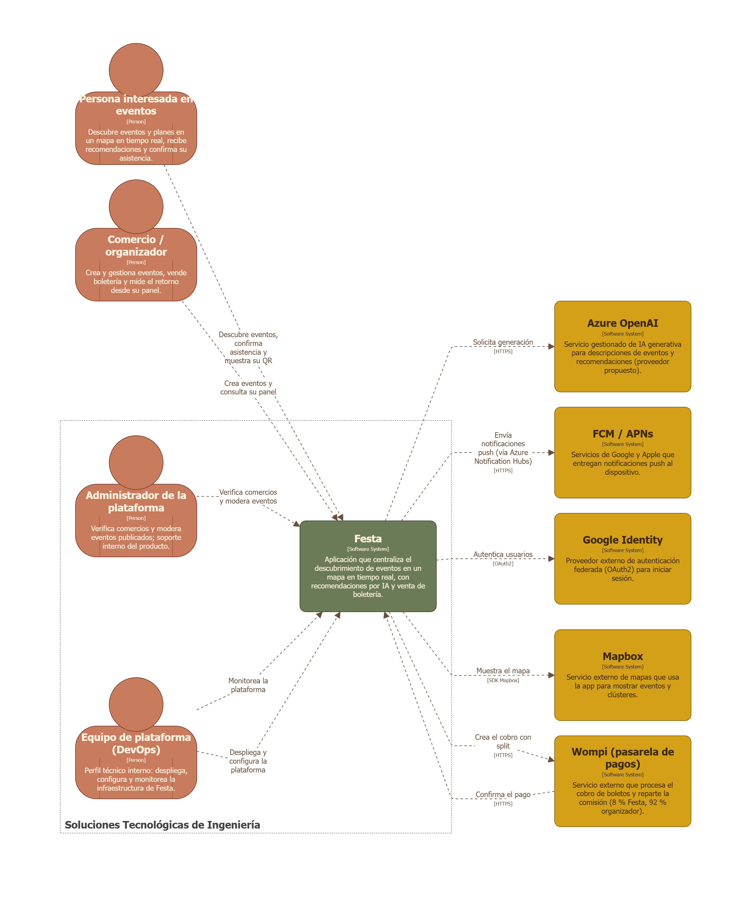

*Generado a partir de la vista `ContextoFesta` definida en [`festa.dsl`](./festa.dsl) (ver sección "Cómo visualizar o exportar los diagramas" en el [README](./README.md)).*

**Cómo leerlo.** Es el nivel 1 del modelo C4: muestra a Festa como una sola caja y alrededor de ella a las personas que la usan y a los sistemas externos con los que habla. No muestra tecnología interna.

### 3.2 Actores

| Actor / Rol | Descripción |
|---|:---:|
| Persona interesada en eventos | Descubre eventos y planes en un mapa en tiempo real, recibe recomendaciones personalizadas y confirma su asistencia. |
| Comercio / organizador | Crea y gestiona eventos, vende boletería y mide el retorno obtenido desde su panel. |
| Administrador de la plataforma | Verifica comercios y modera eventos publicados; soporte interno del producto (equipo Festa). |
| Equipo de plataforma (DevOps) | Perfil técnico interno: despliega, configura y monitorea la infraestructura de Festa. |

### 3.3 Sistemas externos

| Sistema | Descripción |
|---|:---:|
| Wompi (pasarela de pagos) | Servicio externo que procesa el cobro de boletos y distribuye la comisión entre el organizador (92 %) y Festa (8 %) mediante split payment. |
| Azure OpenAI | Servicio gestionado de IA generativa (proveedor propuesto) que genera descripciones de eventos y recomendaciones personalizadas. |
| FCM / APNs | Servicios de Google y Apple que entregan las notificaciones push al dispositivo; Festa los usa a través de Azure Notification Hubs (fase 2). |
| Google Identity | Proveedor externo (OAuth2) de autenticación federada para iniciar sesión. |
| Mapbox | Servicio externo de mapas que usa la app para mostrar eventos y clústeres. |

## 4. Alcance del sistema

### 4.1 Dentro del sistema

- Registro e inicio de sesión de usuarios y comercios (correo o autenticación federada con Google).
- Creación, edición, cancelación y publicación de eventos en un mapa interactivo en tiempo real, con búsqueda y filtrado.
- Generación de recomendaciones personalizadas de eventos y de descripciones de eventos mediante Inteligencia Artificial Generativa.
- Validación de asistencia mediante código QR de un solo uso, escaneado al ingreso del evento.
- Venta de boletería dentro de la app, con retención de una comisión por cada entrada vendida.
- Verificación manual de comercios y moderación de eventos/usuarios reportados por parte del administrador de la plataforma.
- Notificaciones push por eventos cercanos y recordatorios de asistencia.
- Panel de comercio con conteos simples de asistentes y boletos vendidos, para medir retorno.

### 4.2 Fuera del sistema

- Procesamiento directo de pagos con tarjeta o custodia de datos de tarjetahabientes: se delega íntegramente a la pasarela de pagos externa (Wompi), evitando el alcance regulatorio de PCI-DSS.
- Infraestructura de autenticación propia: la autenticación federada (Google) se delega a un proveedor de identidad externo; solo el correo/contraseña es gestionado directamente por Festa.
- Envío físico de notificaciones push: la entrega al dispositivo se delega a Firebase Cloud Messaging y APNs; Festa solo solicita el envío.
- Gamificación y economía de puntos (otorgamiento de XP, canje de puntos por descuentos, sistema de reputación con ranking e insignias): queda fuera del MVP de este semestre, es roadmap post-piloto (*Won't* en la priorización MoSCoW).

## 5. Diagrama de Contenedores

### 5.1 Diagrama

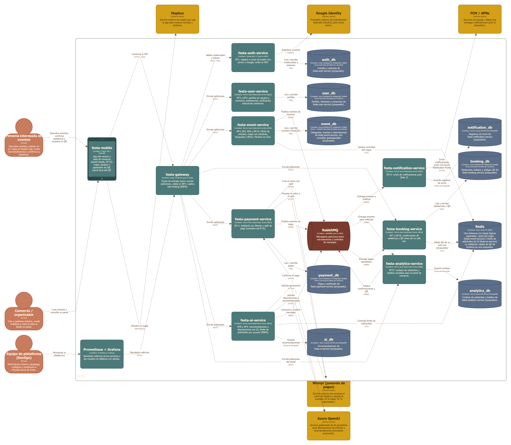

*Vista `ContenedoresFesta` de [`festa.dsl`](./festa.dsl). La imagen es grande: ábrela directamente para acercarla.*

**Cómo leerlo.** Es el nivel 2 del modelo C4: abre la caja de Festa y muestra las piezas que se despliegan por separado (cada `festa-*` es un repositorio). Las flechas indican quién llama a quién y con qué protocolo. Todo el tráfico de la app pasa por el gateway, y los servicios se avisan entre sí por RabbitMQ.

### 5.2 Contenedores

| Contenedor (repositorio) | Tecnología | Responsabilidad | Requisitos |
|---|:---:|---|:---:|
| `festa-mobile` | Flutter (iOS y Android) | App del usuario y vista de comercio: mapa, escáner y generador de QR, caché local del QR. | RF5, RF15, RNF10 |
| `festa-gateway` | Kong 3.9 DB-less (pod en AKS) | Punto de entrada único: enruta, valida el JWT y aplica rate limiting. | RNF4, RNF8 |
| `festa-auth-service` | Spring Boot 3.5 (pod en AKS) | Registro e inicio de sesión con correo y Google; emite el JWT. | RF1 |
| `festa-user-service` | Pod en AKS | Perfiles de usuario y comercio, preferencias y verificación manual de comercios. | RF2, RF3 |
| `festa-event-service` | Pod en AKS | CRUD de eventos, mapa con clústeres, búsqueda y filtros, Parches en Vivo. | RF4, RF5, RF6, RF19 |
| `festa-booking-service` | Pod en AKS | Confirmación de asistencia y QR de un solo uso. | RF7, RF10, RNF7 |
| `festa-payment-service` | Pod en AKS | Boletería con Wompi y split de pago (comisión del 8 %). | RF11, RNF6 |
| `festa-ai-service` | Pod en AKS | Recomendaciones y descripciones con IA; límite de solicitudes por usuario. | RF8, RF9, RNF8 |
| `festa-notification-service` | Pod en AKS | Envío de notificaciones push (fase 2). | RF12 |
| `festa-analytics-service` | Pod en AKS | Conteos de asistentes y boletos vendidos para el panel de comercio. | RF15 |
| RabbitMQ | RabbitMQ | Mensajería asíncrona entre microservicios y contratos de mensajes. | RNF2 |
| Una base de datos por servicio | PostgreSQL (`auth_db`, `user_db`, `event_db` con PostGIS, `booking_db`, `payment_db`) y MongoDB / Cosmos DB API MongoDB (`ai_db`, `notification_db`, `analytics_db`) | Cada servicio es dueño de su base y de su modelo de datos; ninguno lee la base de otro. Motor por servicio: el que define `festa-infra` (rama `feat/fase-0-infra-contratos`); falta confirmarlo con el equipo (ADR 0002). | RNF1 |
| Redis | Azure Cache for Redis (una instancia) | Bases lógicas separadas: caché del mapa de `festa-event-service` y límite de solicitudes de `festa-ai-service`. La validación rápida de QR de booking es una propuesta. El rate limit del gateway lo lleva Kong. | RNF1, RNF7, RNF8 |
| Prometheus + Grafana | Prometheus y Grafana | Métricas, tableros y alertas de los servicios. | RNF3 |

### 5.3 Relaciones principales

- La app llama solo al gateway (HTTPS/WSS); el gateway enruta a cada servicio por REST.
- `festa-auth-service` se federa con Google Identity; `festa-payment-service` cobra con Wompi; `festa-ai-service` consulta a Azure OpenAI; `festa-notification-service` envía push a FCM/APNs; la app muestra el mapa con Mapbox.
- Los servicios publican y consumen eventos en RabbitMQ: pago aprobado, confirmaciones y QR, eventos de dominio y métricas.
- El equipo de plataforma observa el sistema a través de Prometheus + Grafana.

## 6. Diagramas de Componentes

Es el nivel 3 del modelo C4: abre un contenedor y muestra sus piezas internas. Se hizo solo para los tres servicios con la lógica más crítica del proyecto. Los componentes son una propuesta de diseño.

### 6.1 `festa-booking-service` (asistencia y QR de un solo uso)

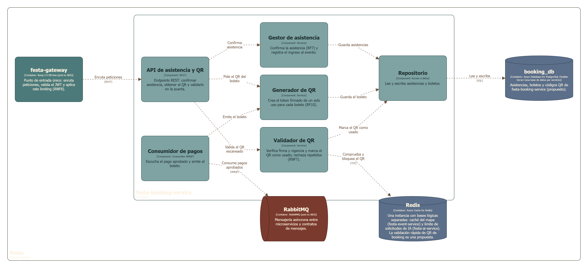

| Componente | Responsabilidad |
|---|---|
| API de asistencia y QR | Endpoints REST: confirmar asistencia, obtener el QR y validarlo en la puerta. |
| Gestor de asistencia | Confirma la asistencia (RF7) y registra el ingreso al evento. |
| Generador de QR | Crea el token firmado de un solo uso para cada boleto (RF10). |
| Validador de QR | Verifica firma y vigencia y marca el QR como usado; rechaza los repetidos (RNF7). |
| Consumidor de pagos | Escucha el pago aprobado en RabbitMQ y emite el boleto. |
| Repositorio | Lee y escribe asistencias y boletos; el validador consulta Redis para bloquear el reuso. |

### 6.2 `festa-payment-service` (cobro y split con Wompi)

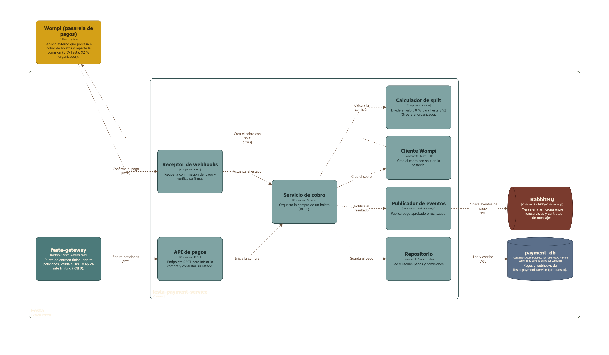

| Componente | Responsabilidad |
|---|---|
| API de pagos | Endpoints REST para iniciar la compra y consultar su estado. |
| Servicio de cobro | Orquesta la compra de un boleto (RF11). |
| Calculador de split | Divide el valor: 8 % para Festa y 92 % para el organizador. |
| Cliente Wompi | Crea el cobro con split en la pasarela. |
| Receptor de webhooks | Recibe la confirmación del pago y verifica su firma. |
| Publicador de eventos | Publica pago aprobado o rechazado en RabbitMQ. |
| Repositorio | Lee y escribe pagos y comisiones. |

### 6.3 `festa-ai-service` (recomendaciones y descripciones con límite de uso)

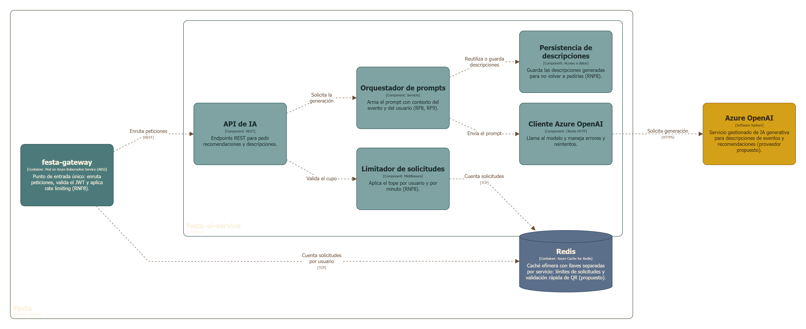

| Componente | Responsabilidad |
|---|---|
| API de IA | Endpoints REST para pedir recomendaciones y descripciones. |
| Limitador de solicitudes | Aplica el tope por usuario y por minuto, con contadores en Redis (RNF8). |
| Orquestador de prompts | Arma el prompt con el contexto del evento y del usuario (RF8, RF9). |
| Persistencia de descripciones | Guarda las descripciones generadas para no volver a pedirlas (RNF8). |
| Cliente Azure OpenAI | Llama al modelo y maneja errores y reintentos. |

## 7. Vista Dinámica: compra de un boleto

### 7.1 Diagrama

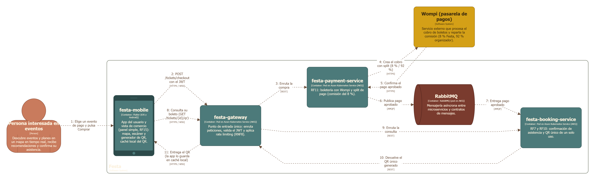

**Cómo leerlo.** A diferencia de los otros diagramas, este muestra una secuencia numerada para un caso de uso (RF11 y RF10), no la estructura. Es el flujo que más pesa en el MVP porque junta el dinero, el QR y la mensajería.

### 7.2 Pasos

| Paso | De → a | Qué ocurre |
|:---:|---|---|
| 1 | Persona → app | Elige un evento de pago y pulsa Comprar. |
| 2 | App → gateway → payment | La app envía la compra con el JWT; el gateway la enruta. |
| 3 | payment → Wompi | Se crea el cobro con split (8 % / 92 %). |
| 4 | Wompi → payment | La pasarela confirma el pago aprobado. |
| 5 | payment → RabbitMQ → booking | Se publica "pago aprobado" y el servicio de reservas lo recibe. |
| 6 | App → gateway → booking | La app consulta su boleto. |
| 7 | booking → gateway → app | Se devuelve el QR único; la app lo guarda en caché local. |

## 8. Diagramas de Clases por Microservicio

Cada microservicio tiene su propio diagrama de clases (no hay uno único para todo el proyecto). Las clases muestran atributos y métodos; las líneas llevan multiplicidad; en amarillo van las enumeraciones. Las referencias a datos de otro servicio (por ejemplo `cuentaId`) son identificadores, no relaciones directas. Son una propuesta de diseño.

### 8.1 `festa-auth-service` (RF1)

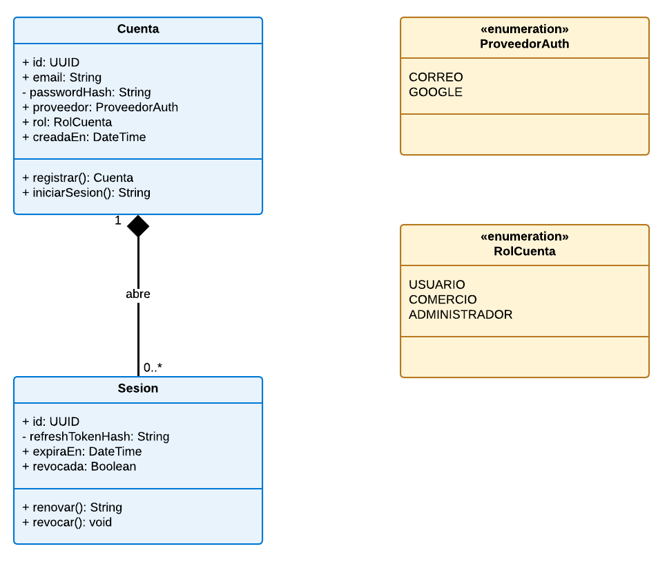

Cuenta de acceso con proveedor (correo o Google) y rol, y las sesiones que se abren con el JWT y el token de renovación.

### 8.2 `festa-user-service` (RF2, RF3)

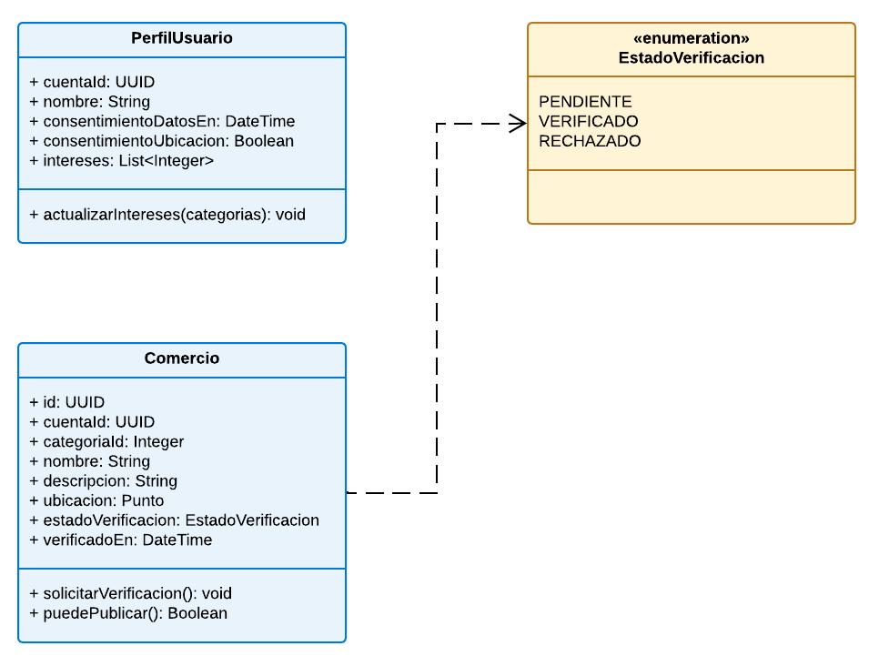

Perfil del usuario con sus intereses y consentimientos (Ley 1581, RNF5), y el comercio con su estado de verificación manual.

### 8.3 `festa-event-service` (RF4, RF5, RF6, RF9, RF19)

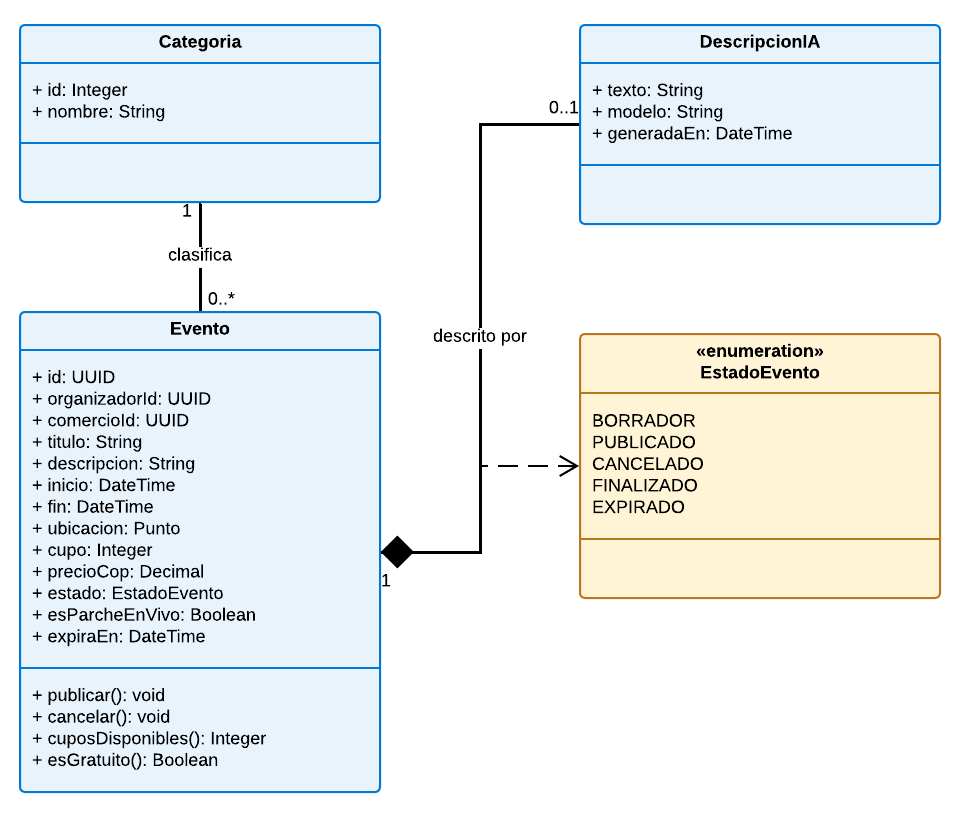

Categorías y eventos (con Parches en Vivo que expiran) y la descripción generada por IA, que se guarda una sola vez (RNF8).

### 8.4 `festa-booking-service` (RF7, RF10)

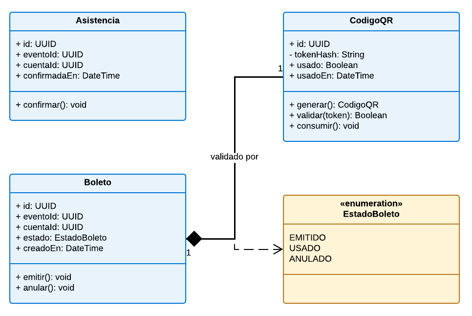

Confirmación de asistencia y boletos, cada uno con su código QR de un solo uso (RNF7).

### 8.5 `festa-payment-service` (RF11)

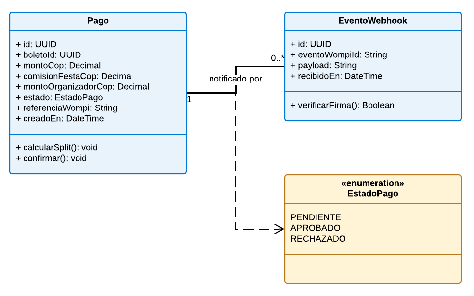

Pago con el reparto de comisión (8 % Festa, 92 % organizador) y los eventos de webhook recibidos de Wompi.

### 8.6 `festa-ai-service` (RF8)

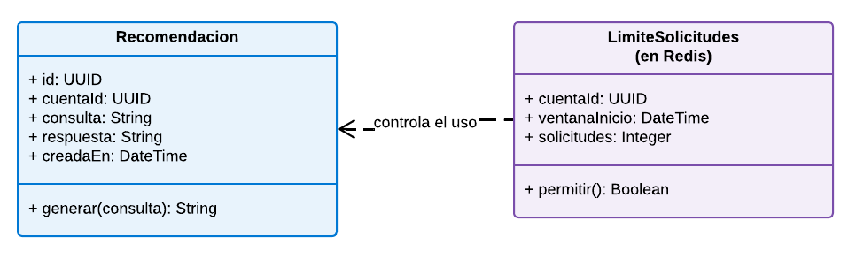

Historial de recomendaciones y el límite de solicitudes por usuario, que vive en Redis y no en MongoDB (RNF8). Su base `ai_db` es MongoDB, según `festa-infra`.

`festa-notification-service` (RF12, fase 2) y `festa-analytics-service` (RF15) no tienen todavía un modelo propio definido: el primero solo reenvía avisos y el segundo se alimenta de los eventos de RabbitMQ. Ambos usan MongoDB según `festa-infra` y se modelarán cuando tengan código.

## 9. Modelos de Base de Datos por Microservicio

Cada servicio tiene su propia base de datos y es dueño de su esquema de PostgreSQL (`auth`, `usuarios`, `eventos`, `reservas`, `pagos`) y es el único que lo modifica. `festa-ai-service`, `festa-notification-service` y `festa-analytics-service` usan MongoDB (colecciones). PK es clave primaria y FK clave foránea; las puntas de las líneas indican cardinalidad.

### 9.1 `festa-auth-service`

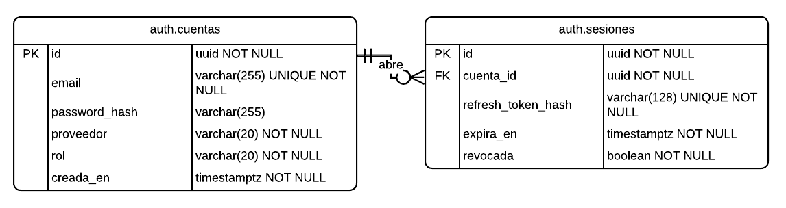

La tabla `auth.sesiones` guarda solo el hash del token de renovación y si fue revocado.

### 9.2 `festa-user-service`

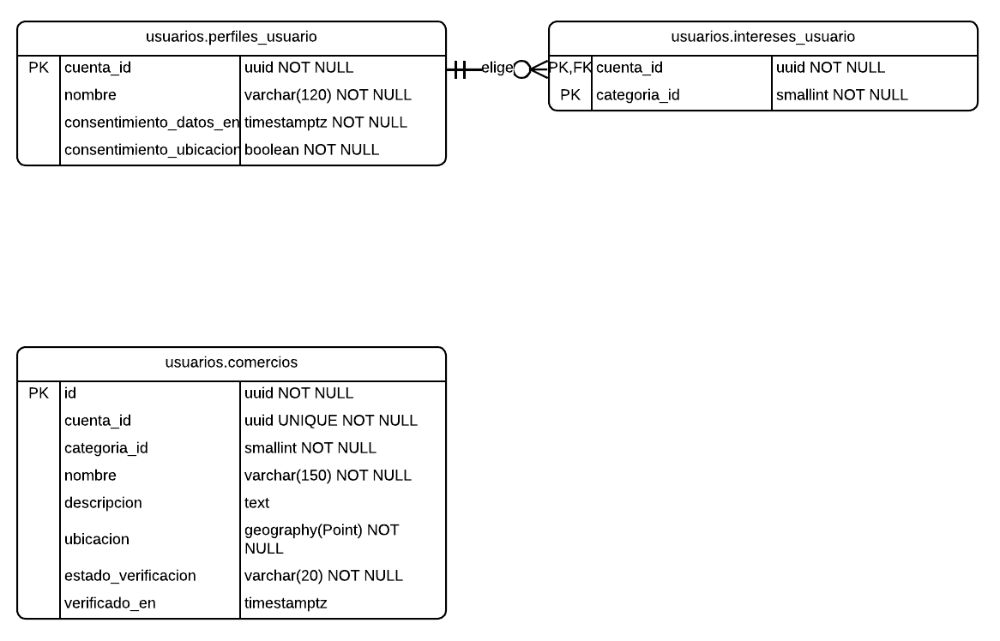

`usuarios.intereses_usuario` es la tabla puente entre el perfil y las categorías, que pertenecen al servicio de eventos.

### 9.3 `festa-event-service`

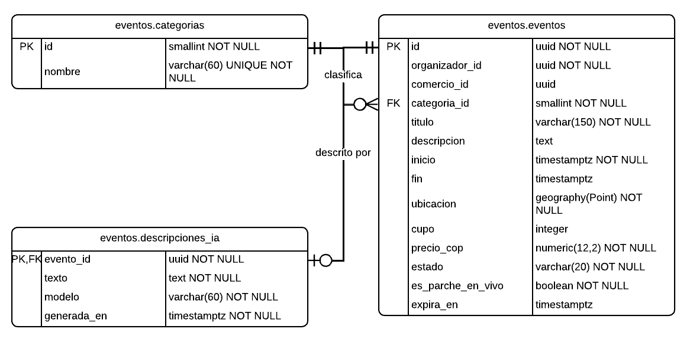

`eventos.eventos.ubicacion` es un `geography(Point)` para el mapa y los clústeres con PostGIS.

### 9.4 `festa-booking-service`

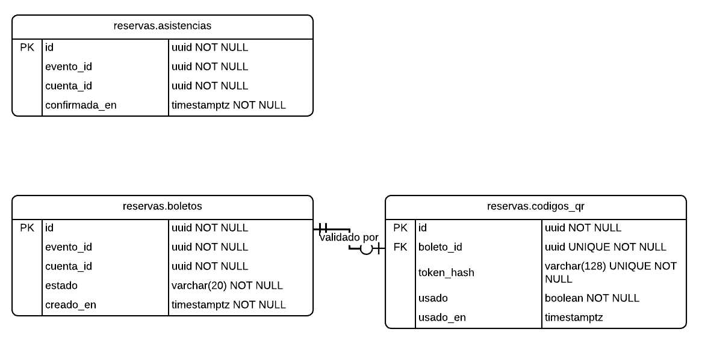

Solo se guarda el hash del token del QR (`token_hash` único) y la bandera `usado`.

### 9.5 `festa-payment-service`

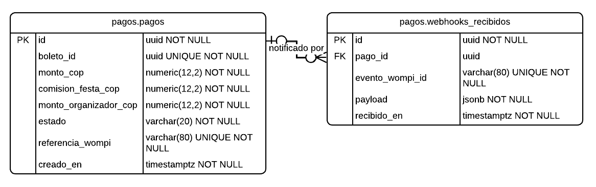

`pagos.webhooks_recibidos.evento_wompi_id` es único para no procesar dos veces el mismo aviso.

### 9.6 `festa-ai-service`

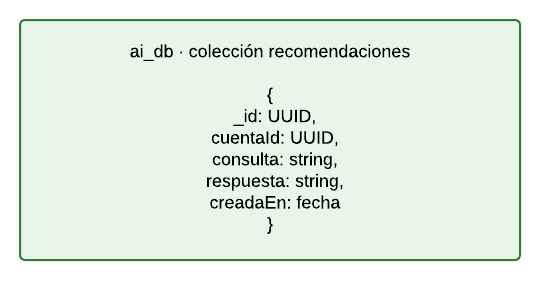

Es una colección de MongoDB (`ai_db.recomendaciones`) y el esquema es una propuesta, porque `festa-ai-service` todavía no tiene código. Las descripciones de eventos (RF9) se guardan en el servicio de eventos, no aquí.

**Nota sobre las claves entre servicios.** Las referencias de un esquema a otro (por ejemplo `reservas.boletos.evento_id`) son lógicas, sin clave foránea, y se validan en el código o con eventos de RabbitMQ. Esto, junto con el uso de MongoDB y Redis, se decide en el ADR 0002.

Los diagramas editables están en el documento de Lucid del proyecto, páginas "Clases y BD · …" de cada servicio.

## 10. Decisiones pendientes y supuestos

| Tema | Estado |
|---|---|
| Plataforma de despliegue: el equipo decidió Azure; la lista exacta de servicios (ADR 0001) sigue pendiente. | Propuesta en Lucid, página "Arquitectura Azure" |
| Almacén de datos: una base de datos por servicio (retroalimentación del profesor, 26-oct-2026). Los motores actuales son los de `festa-infra`; falta confirmarlos con el equipo (ADR 0002). | Decidido el aislamiento; motor por confirmar |
| Proveedor de LLM: se propone Azure OpenAI (ADR 0003). | Pendiente |
| Contratos de mensajes de RabbitMQ (ADR 0004). | Hechos en `festa-infra` (38 eventos, rama `feat/fase-0-infra-contratos`); falta fusionarlos y registrar el ADR |
| RF13, RF14 y RF16-RF18 no tienen repositorio asignado (ADR 0005). | Pendiente |

El despliegue en Azure con los íconos oficiales está en el documento de Lucid del proyecto, página "Arquitectura Azure"; no se modela en C4.

### 10.1 Estado de los repositorios (27-oct-2026)

El trabajo de Carlos está en ramas `feat/*` de tres repositorios, sin PR todavía. Los otros ocho solo tienen el README.

| Repositorio | Rama | Qué incluye |
|---|---|---|
| `festa-infra` | `feat/fase-0-infra-contratos` | Docker Compose local: PostgreSQL con PostGIS (auth, user, event, booking y payment), MongoDB (ai, notification y analytics), Redis, RabbitMQ con su topología, Prometheus y Grafana. Contratos de 38 eventos con validador. |
| `festa-auth-service` | `feat/fase-1-auth-service` | RF1: registro, login con correo y Google, refresh y logout, JWT RS256 y JWKS, borrado de cuenta (Ley 1581), cifrado de datos personales, outbox y pruebas. Spring Boot 3.5. |
| `festa-gateway` | `feat/fase-2-gateway` | Kong 3.9 DB-less con validación de JWT, límite de peticiones por ruta, correlation-id y cabeceras de seguridad. |

Hoy todo corre en Docker Compose local. El despliegue en la nube (AKS u otra) y sus scripts siguen pendientes.
