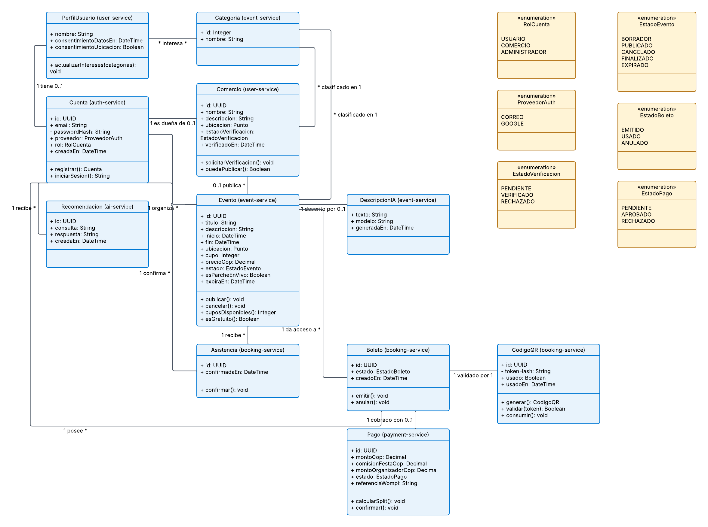
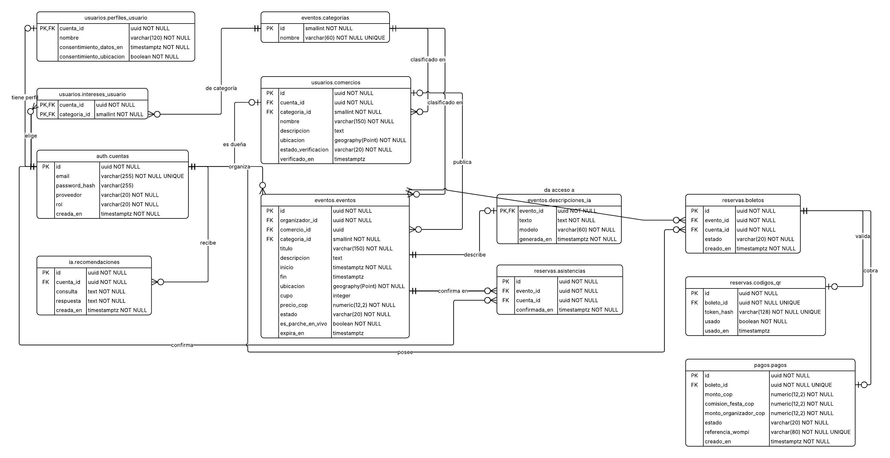

# 📄 Alcance del Sistema — Festa

Basado en `Requerimientos.docx`, en [`requirements.md`](../requirements/requirements.md) y en el modelo C4 de [`festa.dsl`](./festa.dsl). Este documento reúne y explica todos los diagramas de arquitectura de Festa: contexto, contenedores, componentes, vista dinámica, clases y base de datos. Plantilla base: [`dosw-lab4-example/scope-template.md`](https://github.com/lauherrerac/dosw-lab4-example/blob/main/docs/requirements/scope-template.md).

> **Estado:** la arquitectura sigue los repositorios `Desparcha2-SWNT/festa-*` (24-oct-2026), que al 25 de octubre solo tienen README, y el despliegue en Azure decidido por el equipo el 25-oct-2026. Los componentes internos, las clases y las tablas son una **propuesta de diseño**; lo que depende del almacén de datos de cada servicio queda pendiente del ADR 0002.

## 1. Sistema

* **Nombre del sistema:** Festa
* **Objetivo:** El sistema tiene como objetivo centralizar el descubrimiento de eventos y planes en un mapa interactivo en tiempo real, ofrecer recomendaciones personalizadas mediante Inteligencia Artificial Generativa, y dar visibilidad a comercios y organizadores locales — validado mediante un piloto con estudiantes de la Escuela Colombiana de Ingeniería Julio Garavito (ECI).

## 2. Problema a resolver

Los planes y eventos locales se pierden entre publicaciones de redes sociales sin trazabilidad temporal clara, y los comercios pequeños no pueden competir por visibilidad frente a otros negocios sin pagar pauta publicitaria en Instagram o TikTok. Festa resuelve esto centralizando el descubrimiento de eventos en un mapa en tiempo real con recomendaciones de IA, y dando a los comercios un canal de visibilidad y monetización (boletería con comisión, posicionamiento destacado) que no depende de pauta paga en redes sociales externas.

## 3. Diagrama de Contexto

### 3.1 Diagrama

*Generado a partir de la vista `ContextoFesta` definida en [`festa.dsl`](./festa.dsl) (ver sección "Cómo visualizar o exportar los diagramas" en el [README](./README.md)).*

**Cómo leerlo.** Es el nivel 1 del modelo C4: muestra a Festa como una sola caja y alrededor de ella a las personas que la usan y a los sistemas externos con los que habla. No muestra tecnología interna.

### 3.2 Actores

| Actor / Rol | Descripción |
|---|:---:|
| Persona interesada en eventos | Descubre eventos y planes en un mapa en tiempo real, recibe recomendaciones personalizadas y confirma su asistencia. |
| Comercio / organizador | Crea y gestiona eventos, vende boletería y mide el retorno obtenido desde su panel. |
| Administrador de la plataforma | Verifica comercios y modera eventos publicados; soporte interno del producto (equipo Festa). |
| Equipo de plataforma (DevOps) | Perfil técnico interno: despliega, configura y monitorea la infraestructura de Festa. |

### 3.3 Sistemas externos

| Sistema | Descripción |
|---|:---:|
| Wompi (pasarela de pagos) | Servicio externo que procesa el cobro de boletos y distribuye la comisión entre el organizador (92 %) y Festa (8 %) mediante split payment. |
| Azure OpenAI | Servicio gestionado de IA generativa (proveedor propuesto) que genera descripciones de eventos y recomendaciones personalizadas. |
| FCM / APNs | Servicios de Google y Apple que entregan las notificaciones push al dispositivo; Festa los usa a través de Azure Notification Hubs (fase 2). |
| Google Identity | Proveedor externo (OAuth2) de autenticación federada para iniciar sesión. |
| Mapbox | Servicio externo de mapas que usa la app para mostrar eventos y clústeres. |

## 4. Alcance del sistema

### 4.1 Dentro del sistema

- Registro e inicio de sesión de usuarios y comercios (correo o autenticación federada con Google).
- Creación, edición, cancelación y publicación de eventos en un mapa interactivo en tiempo real, con búsqueda y filtrado.
- Generación de recomendaciones personalizadas de eventos y de descripciones de eventos mediante Inteligencia Artificial Generativa.
- Validación de asistencia mediante código QR de un solo uso, escaneado al ingreso del evento.
- Venta de boletería dentro de la app, con retención de una comisión por cada entrada vendida.
- Verificación manual de comercios y moderación de eventos/usuarios reportados por parte del administrador de la plataforma.
- Notificaciones push por eventos cercanos y recordatorios de asistencia.
- Panel de comercio con conteos simples de asistentes y boletos vendidos, para medir retorno.

### 4.2 Fuera del sistema

- Procesamiento directo de pagos con tarjeta o custodia de datos de tarjetahabientes: se delega íntegramente a la pasarela de pagos externa (Wompi), evitando el alcance regulatorio de PCI-DSS.
- Infraestructura de autenticación propia: la autenticación federada (Google) se delega a un proveedor de identidad externo; solo el correo/contraseña es gestionado directamente por Festa.
- Envío físico de notificaciones push: la entrega al dispositivo se delega a Firebase Cloud Messaging y APNs; Festa solo solicita el envío.
- Gamificación y economía de puntos (otorgamiento de XP, canje de puntos por descuentos, sistema de reputación con ranking e insignias): queda fuera del MVP de este semestre, es roadmap post-piloto (*Won't* en la priorización MoSCoW).

## 5. Diagrama de Contenedores

### 5.1 Diagrama

*Vista `ContenedoresFesta` de [`festa.dsl`](./festa.dsl). La imagen es grande: ábrela directamente para acercarla.*

**Cómo leerlo.** Es el nivel 2 del modelo C4: abre la caja de Festa y muestra las piezas que se despliegan por separado (cada `festa-*` es un repositorio). Las flechas indican quién llama a quién y con qué protocolo. Todo el tráfico de la app pasa por el gateway, y los servicios se avisan entre sí por RabbitMQ.

### 5.2 Contenedores

| Contenedor (repositorio) | Tecnología | Responsabilidad | Requisitos |
|---|:---:|---|:---:|
| `festa-mobile` | Flutter (iOS y Android) | App del usuario y vista de comercio: mapa, escáner y generador de QR, caché local del QR. | RF5, RF15, RNF10 |
| `festa-gateway` | Azure Container Apps | Punto de entrada único: enruta, valida el JWT y aplica rate limiting. | RNF4, RNF8 |
| `festa-auth-service` | Azure Container Apps | Registro e inicio de sesión con correo y Google; emite el JWT. | RF1 |
| `festa-user-service` | Azure Container Apps | Perfiles de usuario y comercio, preferencias y verificación manual de comercios. | RF2, RF3 |
| `festa-event-service` | Azure Container Apps | CRUD de eventos, mapa con clústeres, búsqueda y filtros, Parches en Vivo. | RF4, RF5, RF6, RF19 |
| `festa-booking-service` | Azure Container Apps | Confirmación de asistencia y QR de un solo uso. | RF7, RF10, RNF7 |
| `festa-payment-service` | Azure Container Apps | Boletería con Wompi y split de pago (comisión del 8 %). | RF11, RNF6 |
| `festa-ai-service` | Azure Container Apps | Recomendaciones y descripciones con IA; límite de solicitudes por usuario. | RF8, RF9, RNF8 |
| `festa-notification-service` | Azure Container Apps | Envío de notificaciones push (fase 2). | RF12 |
| `festa-analytics-service` | Azure Container Apps | Conteos de asistentes y boletos vendidos para el panel de comercio. | RF15 |
| RabbitMQ | RabbitMQ | Mensajería asíncrona entre microservicios y contratos de mensajes. | RNF2 |
| PostgreSQL, MongoDB, Redis | Azure Database for PostgreSQL + PostGIS, Cosmos DB (API MongoDB), Cache for Redis | Datos relacionales y geoespaciales, datos documentales, caché y límites de uso (propuesto, ADR 0002). | RNF1 |
| Prometheus + Grafana | Prometheus y Grafana | Métricas, tableros y alertas de los servicios. | RNF3 |

### 5.3 Relaciones principales

- La app llama solo al gateway (HTTPS/WSS); el gateway enruta a cada servicio por REST.
- `festa-auth-service` se federa con Google Identity; `festa-payment-service` cobra con Wompi; `festa-ai-service` consulta a Azure OpenAI; `festa-notification-service` envía push a FCM/APNs; la app muestra el mapa con Mapbox.
- Los servicios publican y consumen eventos en RabbitMQ: pago aprobado, confirmaciones y QR, eventos de dominio y métricas.
- El equipo de plataforma observa el sistema a través de Prometheus + Grafana.

## 6. Diagramas de Componentes

Es el nivel 3 del modelo C4: abre un contenedor y muestra sus piezas internas. Se hizo solo para los tres servicios con la lógica más crítica del proyecto. Los componentes son una propuesta de diseño.

### 6.1 `festa-booking-service` (asistencia y QR de un solo uso)

| Componente | Responsabilidad |
|---|---|
| API de asistencia y QR | Endpoints REST: confirmar asistencia, obtener el QR y validarlo en la puerta. |
| Gestor de asistencia | Confirma la asistencia (RF7) y registra el ingreso al evento. |
| Generador de QR | Crea el token firmado de un solo uso para cada boleto (RF10). |
| Validador de QR | Verifica firma y vigencia y marca el QR como usado; rechaza los repetidos (RNF7). |
| Consumidor de pagos | Escucha el pago aprobado en RabbitMQ y emite el boleto. |
| Repositorio | Lee y escribe asistencias y boletos; el validador consulta Redis para bloquear el reuso. |

### 6.2 `festa-payment-service` (cobro y split con Wompi)

| Componente | Responsabilidad |
|---|---|
| API de pagos | Endpoints REST para iniciar la compra y consultar su estado. |
| Servicio de cobro | Orquesta la compra de un boleto (RF11). |
| Calculador de split | Divide el valor: 8 % para Festa y 92 % para el organizador. |
| Cliente Wompi | Crea el cobro con split en la pasarela. |
| Receptor de webhooks | Recibe la confirmación del pago y verifica su firma. |
| Publicador de eventos | Publica pago aprobado o rechazado en RabbitMQ. |
| Repositorio | Lee y escribe pagos y comisiones. |

### 6.3 `festa-ai-service` (recomendaciones y descripciones con límite de uso)

| Componente | Responsabilidad |
|---|---|
| API de IA | Endpoints REST para pedir recomendaciones y descripciones. |
| Limitador de solicitudes | Aplica el tope por usuario y por minuto, con contadores en Redis (RNF8). |
| Orquestador de prompts | Arma el prompt con el contexto del evento y del usuario (RF8, RF9). |
| Persistencia de descripciones | Guarda las descripciones generadas para no volver a pedirlas (RNF8). |
| Cliente Azure OpenAI | Llama al modelo y maneja errores y reintentos. |

## 7. Vista Dinámica: compra de un boleto

### 7.1 Diagrama

**Cómo leerlo.** A diferencia de los otros diagramas, este muestra una secuencia numerada para un caso de uso (RF11 y RF10), no la estructura. Es el flujo que más pesa en el MVP porque junta el dinero, el QR y la mensajería.

### 7.2 Pasos

| Paso | De → a | Qué ocurre |
|:---:|---|---|
| 1 | Persona → app | Elige un evento de pago y pulsa Comprar. |
| 2 | App → gateway → payment | La app envía la compra con el JWT; el gateway la enruta. |
| 3 | payment → Wompi | Se crea el cobro con split (8 % / 92 %). |
| 4 | Wompi → payment | La pasarela confirma el pago aprobado. |
| 5 | payment → RabbitMQ → booking | Se publica "pago aprobado" y el servicio de reservas lo recibe. |
| 6 | App → gateway → booking | La app consulta su boleto. |
| 7 | booking → gateway → app | Se devuelve el QR único; la app lo guarda en caché local. |

## 8. Diagrama de Clases

### 8.1 Diagrama

*Editable en Lucidchart: [Diagrama de clases del dominio](https://lucid.app/lucidchart/2de1f120-8e4d-4848-99a2-2da99f0cabba/edit).*

**Cómo leerlo.** Muestra las clases del MVP con sus atributos y métodos, y entre paréntesis el servicio dueño de cada una. Las líneas llevan la multiplicidad (por ejemplo "1 posee \*"). En amarillo van las enumeraciones.

### 8.2 Clases

| Clase (servicio) | Qué representa | Relaciones clave |
|---|---|---|
| Cuenta (auth) | Identidad de quien entra a la app, con proveedor (correo o Google) y rol. | Tiene un perfil y, si es comercio, un comercio; organiza eventos, confirma asistencias y posee boletos. |
| PerfilUsuario (user) | Datos del usuario y consentimientos de datos y ubicación (Ley 1581, RNF5). | Elige categorías de interés. |
| Comercio (user) | Negocio con ubicación y estado de verificación manual (RF3). | Publica eventos; solo puede publicar si está verificado. |
| Categoria (event) | Clasificación de eventos, comercios e intereses. | Agrupa eventos y comercios. |
| Evento (event) | Plan con fecha, lugar, cupo, precio y estado; incluye Parches en Vivo que expiran. | Tiene una descripción de IA, asistencias y boletos. |
| DescripcionIA (event) | Texto generado una sola vez y guardado (RNF8). | Pertenece a un evento. |
| Asistencia (booking) | Confirmación de asistencia de una cuenta a un evento (RF7). | Une cuenta y evento. |
| Boleto (booking) | Derecho de acceso a un evento. | Tiene un código QR y, si es de pago, un pago. |
| CodigoQR (booking) | Token de un solo uso (solo se guarda su hash). | Valida un boleto; se consume al escanearlo (RNF7). |
| Pago (payment) | Cobro con el reparto de comisión y la referencia de Wompi. | Cobra un boleto. |
| Recomendacion (ai) | Consulta del usuario y respuesta de la IA. | Pertenece a una cuenta. |

Las enumeraciones son `RolCuenta`, `ProveedorAuth`, `EstadoVerificacion`, `EstadoEvento`, `EstadoBoleto` y `EstadoPago`.

## 9. Modelo de Base de Datos

### 9.1 Diagrama

*Editable en Lucidchart: [Modelo de base de datos PostgreSQL](https://lucid.app/lucidchart/9c51e2ca-3b71-45e5-bf66-1a3566100774/edit).*

**Cómo leerlo.** Es un diagrama entidad-relación de las tablas relacionales. El prefijo de cada tabla es el esquema, uno por servicio, para ver quién es dueño de qué. PK es clave primaria y FK clave foránea; las puntas de las líneas indican cardinalidad.

### 9.2 Tablas por servicio

| Esquema (servicio) | Tablas | Notas |
|---|---|---|
| `auth` | `cuentas` | Correo único, hash de contraseña (nulo si entra con Google), proveedor y rol. |
| `usuarios` | `perfiles_usuario`, `intereses_usuario`, `comercios` | Consentimientos con fecha; ubicación del comercio como `geography(Point)`; estado de verificación. |
| `eventos` | `categorias`, `eventos`, `descripciones_ia` | Ubicación como `geography(Point)` para el mapa y los clústeres (PostGIS); `es_parche_en_vivo` y `expira_en` para RF19. |
| `reservas` | `asistencias`, `boletos`, `codigos_qr` | `codigos_qr.token_hash` único y bandera `usado` para el QR de un solo uso. |
| `pagos` | `pagos` | Monto, comisión de Festa, monto del organizador y referencia única de Wompi. |
| `ia` | `recomendaciones` | Historial de consultas y respuestas. |

**Nota sobre las claves entre servicios.** Si cada servicio termina con su propia base de datos, las claves foráneas que cruzan esquemas (por ejemplo `reservas.boletos.evento_id`) serán lógicas y se validarán en el código. Esto, junto con el uso de MongoDB y Redis, se decide en el ADR 0002.

## 10. Decisiones pendientes y supuestos

| Tema | Estado |
|---|---|
| Plataforma de despliegue: el equipo decidió Azure; la lista exacta de servicios (ADR 0001) sigue pendiente. | Propuesta en Lucid, página "Arquitectura Azure" |
| Almacén de datos de cada servicio (ADR 0002). | Pendiente |
| Proveedor de LLM: se propone Azure OpenAI (ADR 0003). | Pendiente |
| Contratos de mensajes de RabbitMQ (ADR 0004). | Pendiente |
| RF13, RF14 y RF16-RF18 no tienen repositorio asignado (ADR 0005). | Pendiente |

El despliegue en Azure con los íconos oficiales está en el documento de Lucid del proyecto, página "Arquitectura Azure"; no se modela en C4.
