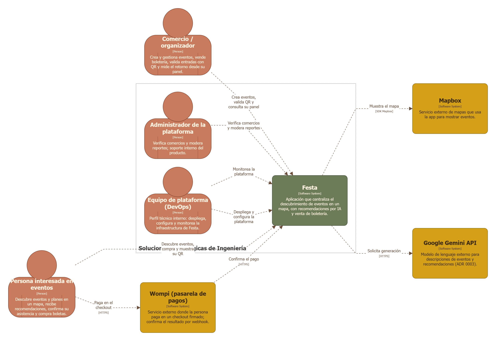
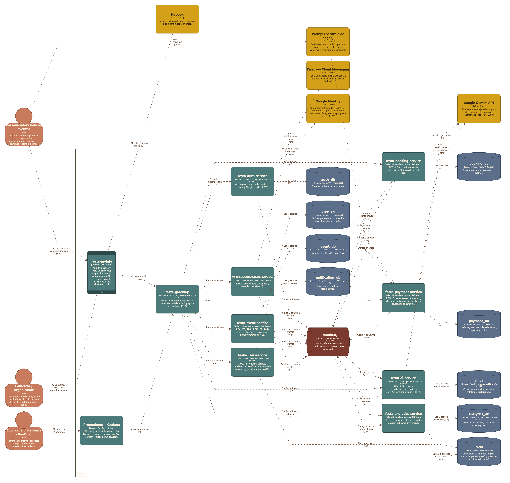
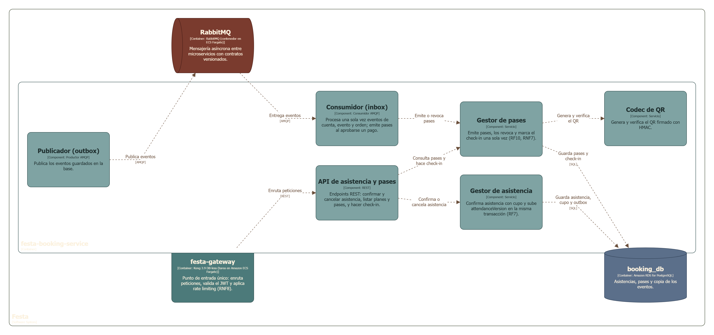
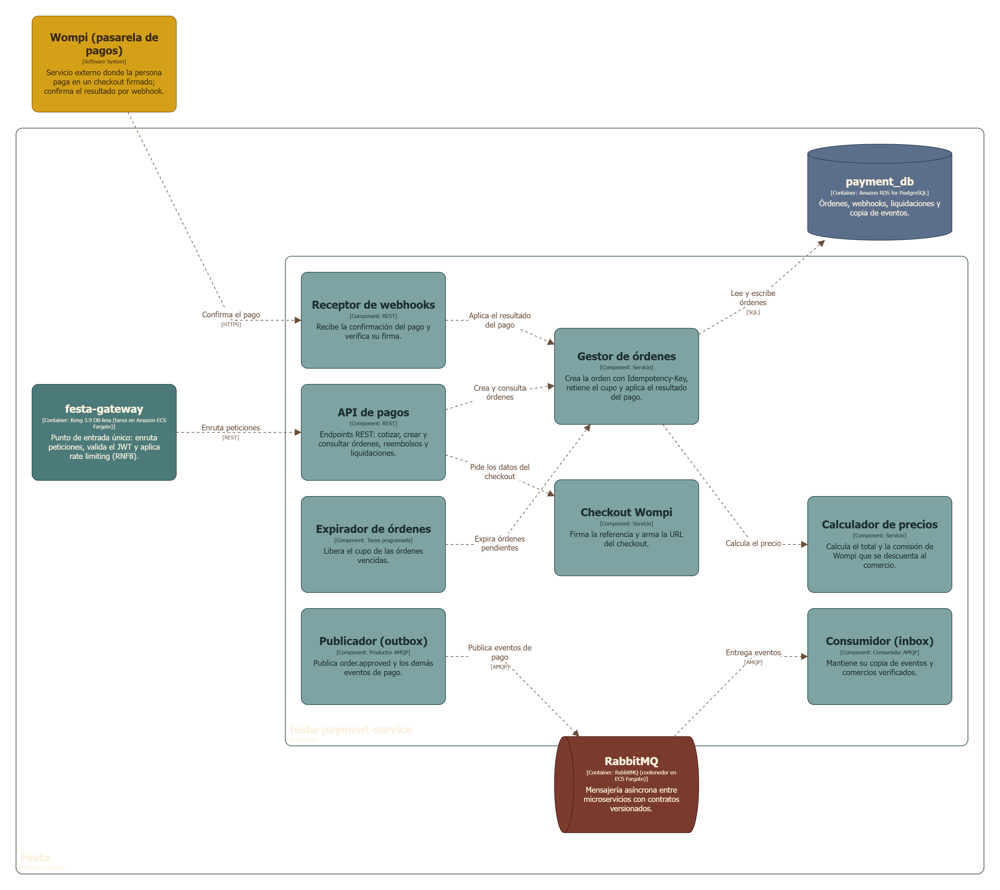
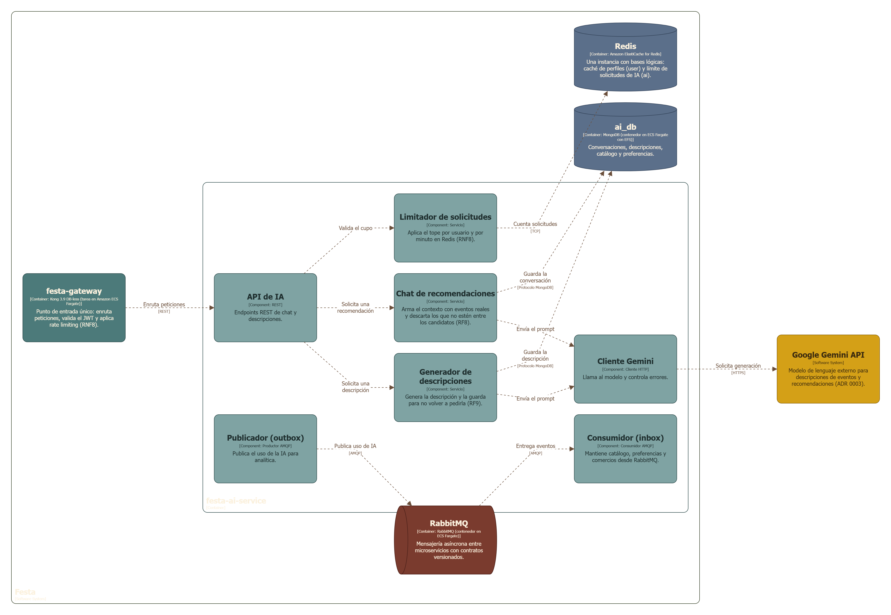
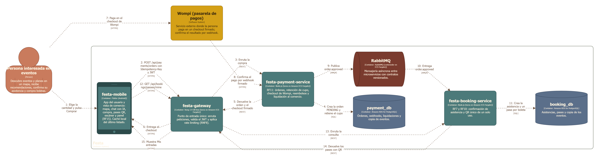

# 📄 Alcance del Sistema — Festa

Basado en `Requerimientos.docx`, en [`requirements.md`](../requirements/requirements.md) y en el modelo C4 de [`festa.dsl`](./festa.dsl). Este documento reúne y explica todos los diagramas de arquitectura de Festa: contexto, contenedores, componentes, vista dinámica, clases y base de datos.

> **Estado (23-nov-2026):** los diagramas se contrastaron con la rama `develop` de cada repositorio `Desparcha2-SWNT/festa-*` y con el Terraform de `festa-infra`. Lo que todavía está en un PR abierto se indica como tal y no se dibuja como hecho. El despliegue sigue el ADR 0001 (AWS).

## 1. Sistema

* **Nombre del sistema:** Festa
* **Objetivo:** El sistema tiene como objetivo centralizar el descubrimiento de eventos y planes en un mapa interactivo que se actualiza al abrirse y al moverse, ofrecer recomendaciones personalizadas mediante Inteligencia Artificial Generativa, y dar visibilidad a comercios y organizadores locales. El piloto se valida con la comunidad de la Escuela Colombiana de Ingeniería Julio Garavito, pero el producto no es exclusivo de ella.

## 2. Problema a resolver

Los planes y eventos locales se pierden entre publicaciones de redes sociales sin trazabilidad temporal clara, y los comercios pequeños no pueden competir por visibilidad frente a otros negocios sin pagar pauta publicitaria en Instagram o TikTok. Festa resuelve esto centralizando el descubrimiento de eventos en un mapa con recomendaciones de IA, y dando a los comercios un canal de visibilidad con la suscripción Festa Pro y venta de boletas, sin depender de pauta paga en redes sociales externas.

## 3. Diagrama de Contexto

### 3.1 Diagrama

*Generado a partir de la vista `ContextoFesta` definida en [`festa.dsl`](./festa.dsl) (ver sección "Cómo visualizar o exportar los diagramas" en el [README](./README.md)).*

**Cómo leerlo.** Es el nivel 1 del modelo C4: muestra a Festa como una sola caja y alrededor de ella a las personas que la usan y a los sistemas externos con los que habla. No muestra tecnología interna.

### 3.2 Actores

| Actor / Rol | Descripción |
|---|:---:|
| Persona interesada en eventos | Descubre eventos y planes en un mapa, recibe recomendaciones personalizadas, confirma su asistencia y compra boletas. |
| Comercio / organizador | Crea y gestiona eventos, vende boletería y mide el retorno obtenido desde su panel. |
| Administrador de la plataforma | Verifica comercios y modera eventos publicados; soporte interno del producto (equipo Festa). |
| Equipo de plataforma (DevOps) | Perfil técnico interno: despliega, configura y monitorea la infraestructura de Festa. |

### 3.3 Sistemas externos

| Sistema | Descripción |
|---|:---:|
| Wompi (pasarela de pagos) | Servicio externo donde la persona paga en un checkout firmado; confirma el resultado a Festa por webhook. Su comisión la paga el comercio: se descuenta de lo que recibe. |
| Google Gemini API | Modelo de lenguaje externo (proveedor decidido en el ADR 0003) que genera descripciones de eventos y recomendaciones personalizadas. |
| Firebase Cloud Messaging | Servicio de Google que entrega las notificaciones push al dispositivo Android; `festa-notification-service` lo llama directamente con `firebase-admin`. |
| Google Identity | Proveedor externo (OAuth2) de autenticación federada para iniciar sesión. |
| Mapbox | Servicio externo de mapas que usa la app para mostrar eventos y clústeres. |

## 4. Alcance del sistema

### 4.1 Dentro del sistema

- Registro e inicio de sesión de usuarios y comercios (correo o autenticación federada con Google).
- Creación, edición, cancelación y publicación de eventos en un mapa interactivo que se actualiza al abrirse y al moverse (sin WebSockets en el MVP), con búsqueda y filtrado.
- Generación de recomendaciones personalizadas de eventos y de descripciones de eventos mediante Inteligencia Artificial Generativa.
- Validación de asistencia mediante código QR de un solo uso, escaneado al ingreso del evento.
- Venta de boletería dentro de la app con el checkout de Wompi. La comisión de la pasarela se descuenta de lo que recibe el comercio.
- Verificación manual de comercios y moderación de eventos/usuarios reportados por parte del administrador de la plataforma.
- Notificaciones push por eventos cercanos y recordatorios de asistencia.
- Panel de comercio con conteos simples de asistentes y boletos vendidos, para medir retorno.

### 4.2 Fuera del sistema

- Procesamiento directo de pagos con tarjeta o custodia de datos de tarjetahabientes: se delega íntegramente a la pasarela de pagos externa (Wompi), evitando el alcance regulatorio de PCI-DSS.
- Infraestructura de autenticación propia: la autenticación federada (Google) se delega a un proveedor de identidad externo; solo el correo/contraseña es gestionado directamente por Festa.
- Envío físico de notificaciones push: la entrega al dispositivo se delega a Firebase Cloud Messaging; Festa solo solicita el envío.
- Gamificación y economía de puntos (otorgamiento de XP, canje de puntos por descuentos, sistema de reputación con ranking e insignias): queda fuera del MVP de este semestre, es roadmap post-piloto (*Won't* en la priorización MoSCoW).

## 5. Diagrama de Contenedores

### 5.1 Diagrama

*Vista `ContenedoresFesta` de [`festa.dsl`](./festa.dsl). La imagen es grande: ábrela directamente para acercarla.*

**Cómo leerlo.** Es el nivel 2 del modelo C4: abre la caja de Festa y muestra las piezas que se despliegan por separado (cada `festa-*` es un repositorio). Las flechas indican quién llama a quién y con qué protocolo. Todo el tráfico de la app pasa por el gateway, y los servicios se avisan entre sí por RabbitMQ.

### 5.2 Contenedores

| Contenedor (repositorio) | Tecnología | Responsabilidad | Requisitos |
|---|:---:|---|:---:|
| `festa-mobile` | Flutter (Android, APK de release) | App del usuario y vista de comercio: mapa, perfil, eventos, asistencia y planes. Compra, pase QR y escáner están en PR abiertos. | RF5, RF15, RNF10 |
| `festa-gateway` | Kong 3.9 DB-less (tarea en Amazon ECS Fargate) | Punto de entrada único: enruta, valida el JWT y aplica rate limiting. | RNF4, RNF8 |
| `festa-auth-service` | Spring Boot 3.5 (tarea en Amazon ECS Fargate) | Registro e inicio de sesión con correo y Google; emite el JWT. | RF1 |
| `festa-user-service` | Tarea en Amazon ECS Fargate | Perfiles de usuario y comercio, preferencias y verificación manual de comercios. | RF2, RF3 |
| `festa-event-service` | Tarea en Amazon ECS Fargate | CRUD de eventos, mapa con clústeres, búsqueda y filtros, Parches en Vivo. | RF4, RF5, RF6, RF19 |
| `festa-booking-service` | Tarea en Amazon ECS Fargate | Confirmación de asistencia y QR de un solo uso. | RF7, RF10, RNF7 |
| `festa-payment-service` | Tarea en Amazon ECS Fargate | Órdenes de boletas, checkout firmado de Wompi, webhook, liquidación al comercio y reembolsos. | RF11, RNF6 |
| `festa-ai-service` | Tarea en Amazon ECS Fargate | Recomendaciones y descripciones con IA; límite de solicitudes por usuario. | RF8, RF9, RNF8 |
| `festa-notification-service` | Tarea en Amazon ECS Fargate | Envío de notificaciones push con Firebase Cloud Messaging y recordatorios. | RF12 |
| `festa-analytics-service` | Tarea en Amazon ECS Fargate | Conteos de asistentes y boletos vendidos para el panel de comercio. | RF15 |
| RabbitMQ | RabbitMQ | Mensajería asíncrona entre microservicios y contratos de mensajes. | RNF2 |
| Una base de datos por servicio | PostgreSQL 16 en Amazon RDS (`auth_db`, `user_db`, `event_db` con PostGIS, `booking_db`, `payment_db`) y MongoDB 7 sin replica set, como contenedor en Fargate con EFS (`ai_db`, `notification_db`, `analytics_db`) | Cada servicio es dueño de su base y de su modelo de datos; ninguno lee la base de otro. | RNF1 |
| Redis | Amazon ElastiCache for Redis | Lo usan dos servicios: `festa-user-service` (caché de perfiles) y `festa-ai-service` (límite de 10 mensajes de chat y 5 descripciones por usuario y minuto). El rate limit del gateway lo lleva Kong. | RNF1, RNF8 |
| Prometheus + Grafana | Prometheus y Grafana (solo en Docker Compose) | Métricas y tableros en el ambiente local; no se despliegan en AWS. | RNF3 |

### 5.3 Relaciones principales

- La app llama solo al gateway (HTTPS); el gateway enruta a cada servicio por REST.
- `festa-auth-service` se federa con Google Identity; `festa-payment-service` firma el checkout y recibe el webhook de Wompi; `festa-ai-service` consulta a la API de Gemini; `festa-notification-service` envía push a Firebase Cloud Messaging; la app muestra el mapa con Mapbox.
- Los servicios publican y consumen eventos versionados en RabbitMQ con outbox e inbox: pagos, asistencia, cuentas, perfiles y eventos de dominio.
- En Docker Compose, el equipo de plataforma observa el sistema con Prometheus + Grafana.

## 6. Diagramas de Componentes

Es el nivel 3 del modelo C4: abre un contenedor y muestra sus piezas internas. Se hizo para los tres servicios con la lógica más crítica del proyecto y refleja el código de `develop`.

### 6.1 `festa-booking-service` (asistencia y QR de un solo uso)

| Componente | Responsabilidad |
|---|---|
| API de asistencia y pases | Endpoints REST: confirmar y cancelar asistencia, listar asistentes y planes, obtener y validar pases. |
| Gestor de asistencia | Confirma o cancela la asistencia y sube `attendanceVersion` en la misma transacción. |
| Gestor de pases | Emite un pase por boleta, lo marca como usado una sola vez y lo revoca en un reembolso. |
| Códec de QR | Genera y verifica el QR firmado (RNF7). |
| Consumidor (inbox) | Procesa sin duplicar los eventos de cuentas, eventos y pagos. |
| Publicador (outbox) | Publica los eventos de asistencia en RabbitMQ. |

### 6.2 `festa-payment-service` (órdenes y checkout con Wompi)

| Componente | Responsabilidad |
|---|---|
| API de pagos | Endpoints REST: cotizar, crear y consultar órdenes, reembolsos y liquidaciones. |
| Gestor de órdenes | Crea la orden con `Idempotency-Key`, retiene el cupo y aplica el resultado del pago (RF11). |
| Calculador de precios | Calcula el total y la comisión de Wompi que se descuenta al comercio. |
| Checkout Wompi | Firma la referencia y arma la URL del checkout; Festa no crea la transacción. |
| Receptor de webhooks | Recibe la confirmación del pago y verifica su firma. |
| Expirador de órdenes | Libera el cupo de las órdenes pendientes vencidas. |
| Consumidor (inbox) | Mantiene las copias de eventos y comercios verificados. |
| Publicador (outbox) | Publica los eventos de pago en RabbitMQ. |

### 6.3 `festa-ai-service` (recomendaciones y descripciones con límite de uso)

| Componente | Responsabilidad |
|---|---|
| API de IA | Endpoints REST de chat y descripciones. |
| Limitador de solicitudes | Aplica el tope por usuario y por minuto con contadores en Redis (RNF8). |
| Chat de recomendaciones | Arma el contexto con el catálogo y descarta los eventos que el modelo no puede respaldar (RF8). |
| Generador de descripciones | Genera la descripción y la guarda para no volver a pedirla (RF9, RNF8). |
| Cliente Gemini | Llama al modelo y maneja sus errores. |
| Consumidor (inbox) | Mantiene el catálogo, las preferencias y el borrado de cuentas. |
| Publicador (outbox) | Publica el uso de IA en RabbitMQ. |

## 7. Vista Dinámica: compra de un boleto

### 7.1 Diagrama

**Cómo leerlo.** A diferencia de los otros diagramas, este muestra una secuencia numerada para un caso de uso (RF11 y RF10), no la estructura. Es el flujo que más pesa en el MVP porque junta el dinero, el QR y la mensajería.

### 7.2 Pasos

| Paso | De → a | Qué ocurre |
|:---:|---|---|
| 1 | Persona → app | Elige un evento de pago y pulsa Comprar. |
| 2 | App → gateway → payment | Crea la orden con `Idempotency-Key`; payment retiene el cupo. |
| 3 | payment → app | Devuelve los datos firmados del checkout de Wompi. |
| 4 | Persona → Wompi | Paga en el checkout; Festa no toca los datos de la tarjeta. |
| 5 | Wompi → payment | El webhook firmado confirma el resultado. |
| 6 | payment → RabbitMQ → booking | Se publica el pago aprobado y booking emite un pase por boleta. |
| 7 | App → gateway → booking | La app consulta sus pases y muestra el QR. |

## 8. Diagramas de Clases por Microservicio

Cada microservicio tiene su propio diagrama de clases, hecho a partir de su código en `develop`. Las referencias a datos de otro servicio (por ejemplo `userId`) son identificadores, no relaciones directas.

| Servicio | Requisitos | Diagrama |
|---|---|---|
| `festa-auth-service` | RF1 | [clases](./diagramas/05-clases/auth-service.png) |
| `festa-user-service` | RF2, RF3 | [clases](./diagramas/05-clases/user-service.png) |
| `festa-event-service` | RF4, RF5, RF6, RF19 | [clases](./diagramas/05-clases/event-service.png) |
| `festa-booking-service` | RF7, RF10 | [clases](./diagramas/05-clases/booking-service.png) |
| `festa-payment-service` | RF11 | [clases](./diagramas/05-clases/payment-service.png) |
| `festa-ai-service` | RF8, RF9 | [clases](./diagramas/05-clases/ai-service.png) |
| `festa-analytics-service` | RF15 | [clases](./diagramas/05-clases/analytics-service.png) |
| `festa-notification-service` | RF12 | [clases](./diagramas/05-clases/notification-service.png) |

## 9. Modelos de Base de Datos por Microservicio

Cada servicio es dueño de su base y es el único que la modifica. Auth, user, event, booking y payment usan PostgreSQL 16; ai, analytics y notification usan MongoDB 7 sin replica set, por lo que sus escrituras atómicas son condicionales sobre un solo documento.

| Servicio | Motor | Modelo |
|---|---|---|
| `festa-auth-service` | PostgreSQL | [`auth_db`](./diagramas/06-base-de-datos/auth-service.png) |
| `festa-user-service` | PostgreSQL | [`user_db`](./diagramas/06-base-de-datos/user-service.png) |
| `festa-event-service` | PostgreSQL + PostGIS | [`event_db`](./diagramas/06-base-de-datos/event-service.png) |
| `festa-booking-service` | PostgreSQL | [`booking_db`](./diagramas/06-base-de-datos/booking-service.png) |
| `festa-payment-service` | PostgreSQL | [`payment_db`](./diagramas/06-base-de-datos/payment-service.png) |
| `festa-ai-service` | MongoDB | [`ai_db`](./diagramas/06-base-de-datos/ai-service.png) |
| `festa-analytics-service` | MongoDB | [`analytics_db`](./diagramas/06-base-de-datos/analytics-service.png) |
| `festa-notification-service` | MongoDB | [`notification_db`](./diagramas/06-base-de-datos/notification-service.png) |

**Nota sobre las claves entre servicios.** Las referencias de una base a otra son lógicas, sin clave foránea, y se mantienen con eventos de RabbitMQ.

Los diagramas editables están en el documento de Lucid del proyecto, páginas "Clases y BD · …" de cada servicio.

## 10. Otras vistas

| Vista | Imagen |
|---|---|
| Proceso de negocio (BPMN) | [ProcesoBPMN](./diagramas/08-proceso/ProcesoBPMN.png) |
| Arquitectura de microservicios | [ArquitecturaMicroservicios](./diagramas/09-despliegue/ArquitecturaMicroservicios.png) |
| Despliegue en AWS | [DespliegueAWS](./diagramas/09-despliegue/DespliegueAWS.png) |
| Secuencia: registro e inicio de sesión | [RegistroInicioSesion](./diagramas/07-secuencias/RegistroInicioSesion.png) |
| Secuencia: crear evento | [CrearEvento](./diagramas/07-secuencias/CrearEvento.png) |
| Secuencia: confirmar asistencia | [ConfirmarAsistencia](./diagramas/07-secuencias/ConfirmarAsistencia.png) |
| Secuencia: descripción con IA | [DescripcionIA](./diagramas/07-secuencias/DescripcionIA.png) |
| Secuencia: comprar boleta | [ComprarBoleta](./diagramas/07-secuencias/ComprarBoleta.png) |
| Secuencia: validar QR | [ValidarQR](./diagramas/07-secuencias/ValidarQR.png) |

## 11. Decisiones pendientes

| Tema | Estado |
|---|---|
| Quién paga el chat de IA del público (tope por usuario o cupo de Festa Pro). | Pendiente del equipo; hoy el tope es por minuto |
| Reparto del 8 % de SCRUM-27 frente a Festa Pro. | Discrepancia abierta en Jira; el modelo oficial es Festa Pro |
| Replica set de MongoDB (SCRUM-130). | Pendiente del equipo |
| Alcance de «sin Firebase»: notification usa Firebase Cloud Messaging. | Pendiente de aclarar |
| RF13, RF14 y RF16-RF18 sin repositorio asignado (ADR 0005). | Pendiente |

### 11.1 Estado de los repositorios (23-nov-2026)

El código de los servicios está en `develop`. La promoción a `main` está en PR abiertos y se aprueba cuando el despliegue en AWS esté encendido. En la app, la compra, el pase QR y el escáner siguen en PR abiertos.
